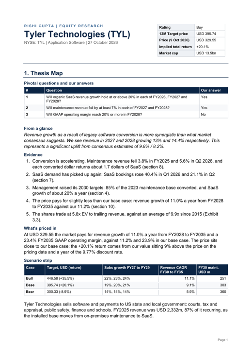
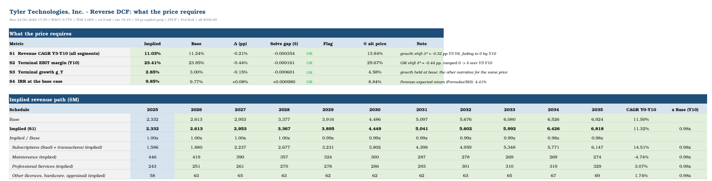

# Rishi Gupta · Equity Research

**Sell-side style equity research on US and ASX stocks.** 

**[Website](https://rishi-gupta2004.github.io/equity-research/)** · **[Substack](https://rishireport.substack.com)** · **[LinkedIn](https://www.linkedin.com/in/rishi-gupta)** · Sydney, Australia

---

## Published research

| Date | Company | Note | Rating | 12m target |
|---|---|---|---|---|
| 27 Oct 2026 | Tyler Technologies (NYSE: TYL) | [Initiation of coverage](research/2026-10-27-TYL-initiation/) · [PDF](research/2026-10-27-TYL-initiation/TYL-Initiation-2026-10-27.pdf) | Buy | US$395.74 |

**Variant view, from the note:** *"Revenue growth as a result of legacy software conversion is more synergistic than what market consensus suggests. We see revenue in 2027 and 2028 growing 13% and 14.4% respectively. This represents a significant uplift from consensus estimates of 9.8% / 8.2%."*

**Since publication:** the stock passed the target on 2 November 2026. Two of the three falsifiers are now at risk after the Q3 print. Every call stays on the [track record](research/README.md), whichever way it goes.

**Next:** Macquarie Technology Group (ASX: MAQ), initiation in progress.

 

---

## How I work

| | |
|---|---|
| [Research process](framework/README.md) | Five stages, from private business model teardowns to published notes and quarterly monitoring |
| [Initiation structure](framework/initiation-structure.md) | A 20-section, roughly 24-page format with four gates where drafting stops for analyst judgement |
| [Quality control](framework/quality-control.md) | A 27-point pre-publication tie-out, built from errors found in published broker research |
| [Investment policy](framework/investment-policy.md) | The rules for an AUD 10,000 notional portfolio that holds the research to account |
| [How I use AI](framework/ai-workflow.md) | AI handles data, exhibits, checking and the Red Team. The thesis, rating and conclusions are mine |

---

## Valuation engine: Model RG

A company-agnostic valuation engine in Excel VBA: forward DCF, a reverse DCF solver, Monte Carlo with correlated draws, scenarios and Penman reformulation. It has about 7,500 lines of code and 394 named ranges. [See how it works](models/model-rg/)

---

## Repository map

| Folder | Contents |
|---|---|
| [`research/`](research/) | Published notes, one folder each, and the track record |
| [`framework/`](framework/) | The rules the research is built to |
| [`models/model-rg/`](models/model-rg/) | The valuation engine, with screenshots from live runs |
| [`early-work/`](early-work/) | The first DCF and Monte Carlo tools, built in 2025 |

---

## About

<!-- Rishi: your bio goes here. -->

- Client Services Representative - Analyst, CMC Markets, Sydney (since January 2026)
- Bachelor of Business Administration, Finance and Accounting, University of Wollongong (2025). [Academic record](https://rishi-gupta2004.github.io/AcademicTranscpript/)

**Contact:** [Rishi.Gupta2004@protonmail.com](mailto:Rishi.Gupta2004@protonmail.com) · [LinkedIn](https://www.linkedin.com/in/rishi-gupta)

---

All research here is personal, prepared in a personal capacity, and does not represent the views of any employer. It is not investment advice and takes no account of any person's objectives, financial situation or needs. No Australian Financial Services Licence is held.
