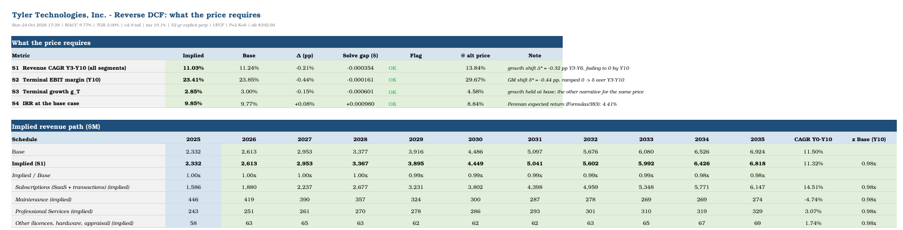
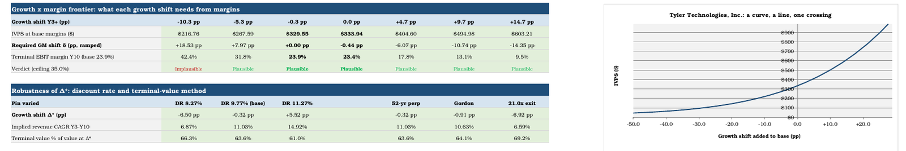
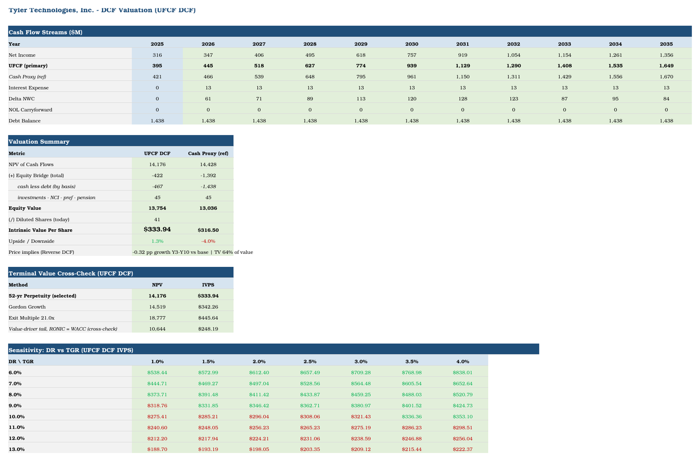
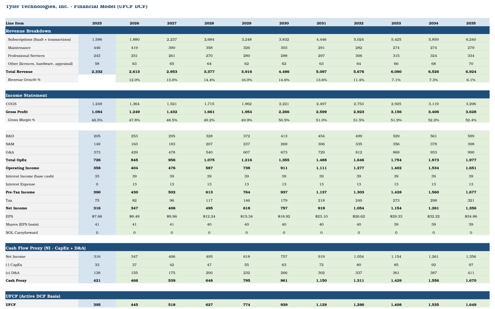
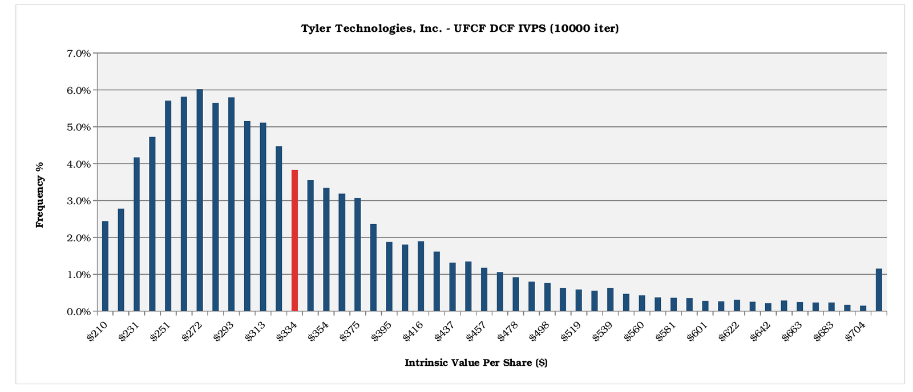
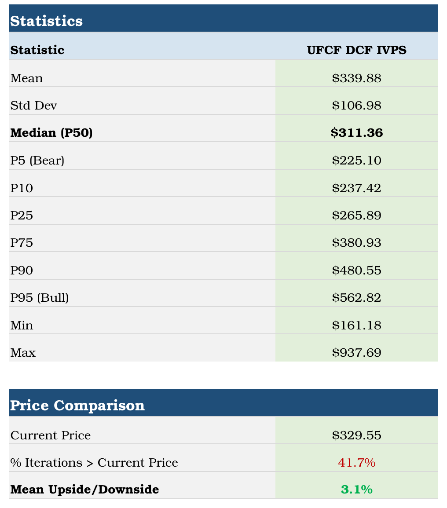

# Model RG: Valuation Engine

A company-agnostic valuation engine in Excel and VBA. Every covered name gets its own copy, and no rated note is published without one. The screenshots below are from the run behind the [Tyler Technologies initiation](../../research/2026-10-27-TYL-initiation/), dated 24 October 2026.

| | |
|---|---|
| Current version | Workbook v18, engine v5.0 (October 2026) |
| Size | 10 sheets, about 7,500 lines of VBA across 22 modules, 394 named ranges |
| Inputs | One Assumptions sheet. Everything else is generated |
| Currencies | USD or AUD |
| Out of scope | Banks, insurers and REITs, blocked at setup |

## The reverse DCF: what the price requires

The engine solves for the path the current share price already pays for. It reports four implied variables against the base case: revenue growth, terminal EBIT margin, terminal growth, and the IRR at the base case. Each solve is checked to a tolerance of US$0.001 a share.

It then maps the trade-off between growth and margin: for each growth assumption, the margin shift needed to justify the price, and whether that margin is plausible against a ceiling. A robustness block re-solves under different discount rates and terminal-value methods.

## Forward DCF

Unlevered free cash flow is the primary basis, with a cash-proxy basis (net income plus D&A less capex) kept as a cross-check. Terminal value is cross-checked across methods (explicit perpetuity, Gordon growth, exit multiple), and a sensitivity grid runs the discount rate against terminal growth.

*Values are at the model's 31 December 2025 valuation date. The note's US$395.74 target is the US$333.94 value per share rolled forward at the 9.77% WACC to the target date.*

## Forecast

Up to four revenue segments, each with its own growth and gross margin path. Opex is forecast line by line (R&D, S&M, G&A), then interest, tax with loss carry-forward, working capital and the cash flow bridge.

## Monte Carlo simulation

Configurable iterations (10,000 in the TYL run) across more than 12 variables. Draws can be PERT, normal, triangular, uniform or lognormal, with cross-correlation between parameters, autocorrelated revenue shocks and mean reversion. A fixed random seed makes every run reproducible. The output reports what share of outcomes sits above the current price.

## What else is in it

- **Equity bridge** covering cash, debt, equity investments, minority interests, preferred equity and the after-tax pension deficit.
- **IFRS 16 adjustment:** lease costs are stripped back into cash flows for IFRS reporters.
- **Terminal reinvestment cross-check:** an optional value-driver tail that makes terminal growth pay for itself at a stated return on new capital, so the terminal value can be tested for free growth.
- **Asset-heavy mode:** a fixed and variable cost structure with a PP&E schedule, for manufacturers and infrastructure.
- **Penman reformulation:** operating and financing activities separated on the balance sheet and income statement.
- **Scenario engine:** bull, base and bear with year-level overrides.
- **Input audit:** flags blank or error inputs before a run, so the model doesn't silently value a phantom company.

## Version history

| Version | Date | Change |
|---|---|---|
| v7 | April 2026 | First public version: dual-basis DCF, Monte Carlo with correlated draws, scenarios, segments, Penman reformulation |
| v15 | September 2026 | Reverse DCF solver, so every valuation section can lead with what the price implies |
| v16 to v18 | October 2026 | Engine v5.0: unlevered FCF as the primary basis, a wider equity bridge, IFRS 16 adjustment, terminal reinvestment cross-check, input audit |

The workbook itself isn't published. Earlier standalone projects that led to it are in [early work](../../early-work/).
