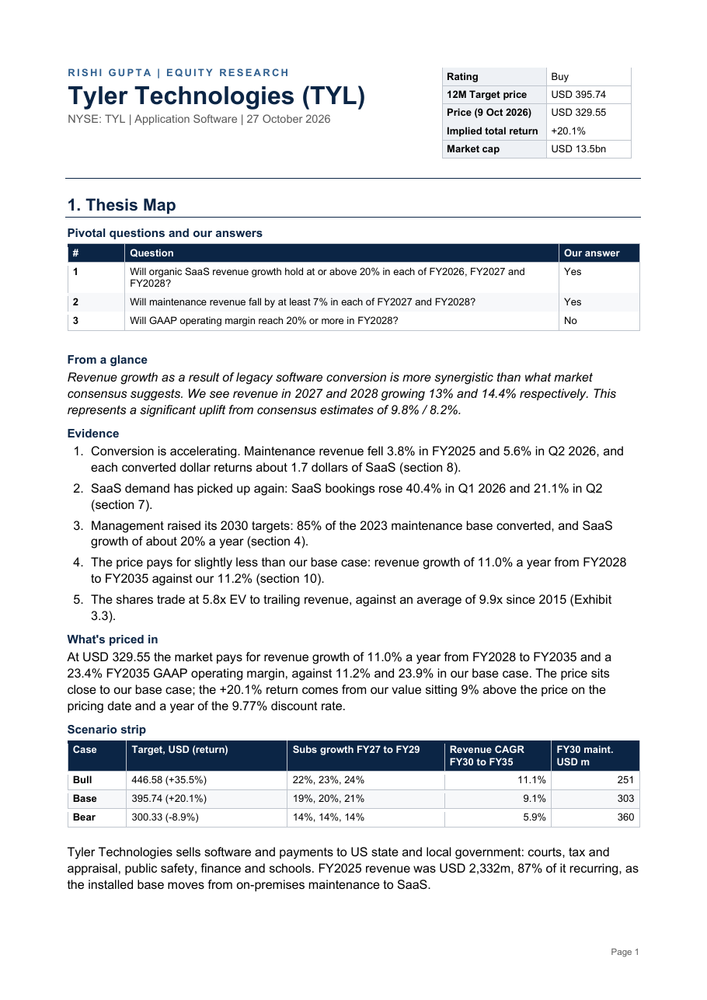

# Tyler Technologies (NYSE: TYL): Initiation of Coverage

**Published 27 October 2026** · 18 pages · [Read the full note (PDF)](TYL-Initiation-2026-10-27.pdf)

| Rating | 12-month target | Reference price | Implied total return | Conviction |
|---|---|---|---|---|
| **Buy** | **US$395.74** (to 27 Oct 2027) | US$329.55 (close, 9 Oct 2026) | **+20.1%** | High |

## The call in brief

Tyler sells software and payments to US state and local government: courts, tax and appraisal, public safety, finance and schools. FY2025 revenue was US$2,332m, 87% of it recurring, as the installed base moves from on-premises maintenance to SaaS.

**Variant view (from the note):**

> *Revenue growth as a result of legacy software conversion is more synergistic than what market consensus suggests. We see revenue in 2027 and 2028 growing 13% and 14.4% respectively. This represents a significant uplift from consensus estimates of 9.8% / 8.2%.*

## Pivotal questions

| # | Question | Our answer |
|---|---|---|
| 1 | Will organic SaaS revenue growth hold at or above 20% in each of FY2026, FY2027 and FY2028? | Yes |
| 2 | Will maintenance revenue fall by at least 7% in each of FY2027 and FY2028? | Yes |
| 3 | Will GAAP operating margin reach 20% or more in FY2028? | No |

## What the price implied

The valuation section opens with a reverse DCF run in [Model RG](../../models/model-rg/). At US$329.55 the market was paying for revenue growth of 11.0% a year from FY2028 to FY2035 and a 23.4% FY2035 GAAP operating margin, against 11.2% and 23.9% in our base case.

| Scenario | Probability | Target, US$ | Return | Subscription growth FY27 to FY29 | Revenue CAGR FY30 to FY35 |
|---|---|---|---|---|---|
| Bull | 25% | 446.58 | +35.5% | 22%, 23%, 24% | 11.1% |
| Base | 50% | 395.74 | +20.1% | 19%, 20%, 21% | 9.1% |
| Bear | 25% | 300.33 | -8.9% | 14%, 14%, 14% | 5.9% |
| **Probability-weighted** | 100% | 384.60 | +16.7% | | |

## Falsifiers and where they stand

Three conditions committed before publication. If any one is met, the thesis is wrong.

| # | Falsifier | Status at 13 Nov 2026 |
|---|---|---|
| 1 | Organic SaaS growth below 18% for two consecutive quarters, from Q3 2026 | **At risk.** Q3 printed 16.3% (reported SaaS growth of 21.2% less US$9.8m of acquired revenue). Q4, reported in February 2027, decides it |
| 2 | Maintenance revenue declines by less than 5% for two consecutive quarters in 2027 | Not yet testable. The window opens with Q1 2027 |
| 3 | FY2026 revenue below US$2,575m, the top of the original guidance range | **At risk.** Management trimmed the top of FY2026 guidance to US$2,565m in October. Resolves in February 2027 |

## Since publication

| | Price, US$ | Change |
|---|---|---|
| Reference price (9 Oct 2026) | 329.55 | |
| Close on publication day (27 Oct 2026) | 378.62 | +14.9% from reference |
| First close above target (2 Nov 2026) | 403.94 | |
| Latest close (13 Nov 2026) | 424.06 | +28.7% from reference; +12.0% from publication; 7.2% above target |

Absolute share price moves, not relative to a benchmark. No revised target has been published. See the [track record](../README.md) for how outcomes are logged.

## What's in the note

Thesis map · catalysts · industry structure and the bear case on it · the business and its economics · peer map · three pivotal questions, each with its own evidence build · what the price implies (reverse DCF) · forward DCF and target price · scenarios with probabilities · falsifiers and a monitoring set · **Red Team** (an adversarial section arguing against our own rating) · conclusion · disclosures.

---

*Personal research, prepared in a personal capacity. Not investment advice, and not the view of any employer. The notional research portfolio did not hold TYL at publication.*
